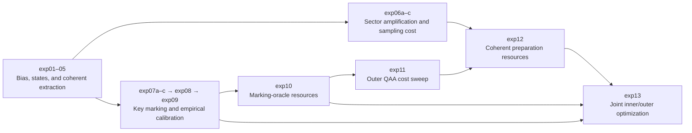
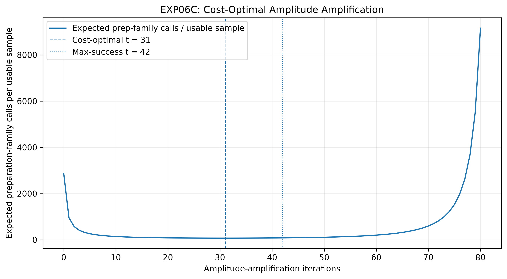
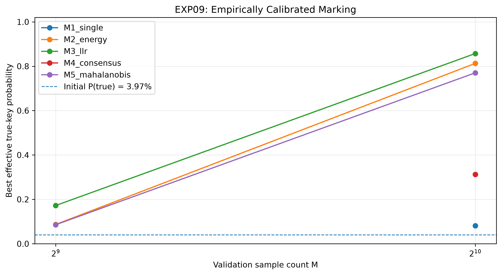
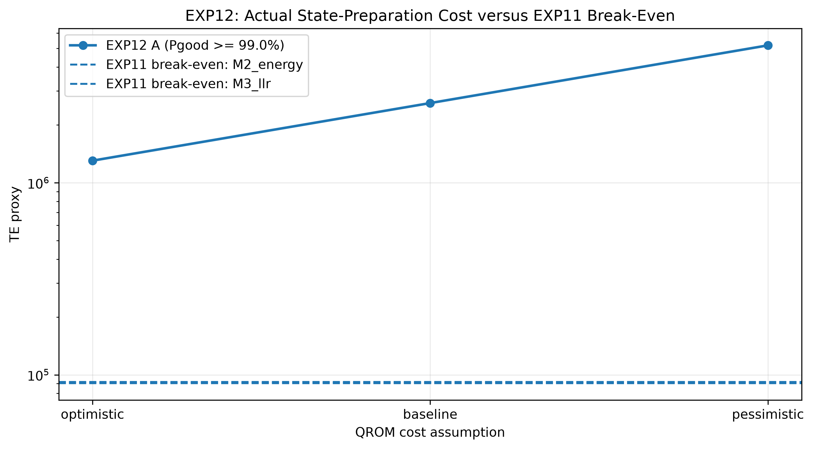
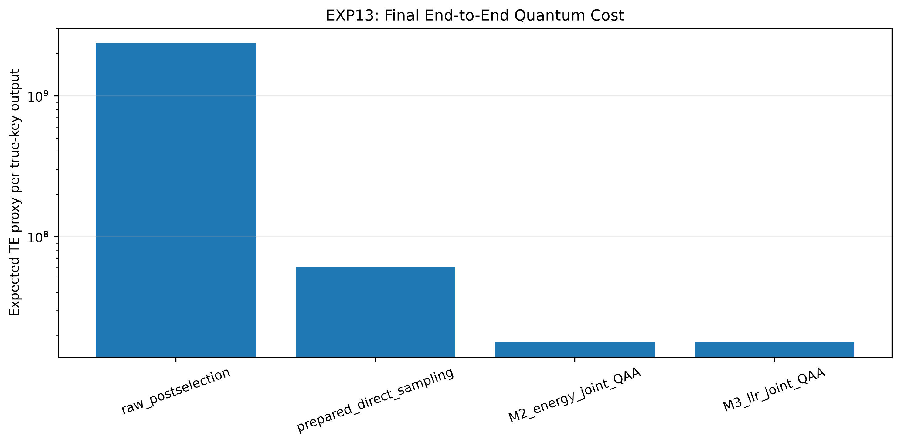

# Quantum Correlation Cryptanalysis

**From classical linear bias to a resource-aware quantum key-extraction benchmark.**


A research implementation exploring how linear-cryptanalytic correlations can be encoded into quantum amplitudes and used for subkey extraction. Experiments **exp01–13**, comprising **17 scripts** including the exp06a–c and exp07a–c variants, connect a classical attack on the **16-bit, 4-round Heys SPN** to coherent extraction, amplitude amplification, statistical key marking, and logical resource estimation.

> **Latest result · exp13:** jointly optimizing inner sector amplification and outer key-marking amplification gives a modeled **72.99% true-key probability per execution** at **17.69 million Toffoli-equivalent (TE) units per true-key outcome** for the baseline M3 LLR strategy. Its modeled cost is **28.94% of prepared direct sampling** and **20.81% lower than fixing the inner sector target at 99%**. These are comparisons among quantum strategies in one logical cost model, not a demonstrated speedup over classical cryptanalysis.

[Experiment overview](#experiment-overview) · [Core idea](#core-idea) · [Results](#results) · [Final benchmark](#final-benchmark) · [Quick start](#quick-start) · [Repository guide](#repository-guide) · [Scope and limitations](#scope-and-limitations)

## Experiment overview

### Foundation · exp01–05

| Experiment | Question | Method | Saved result |
| :-- | :-- | :-- | :-- |
| [**exp01 · Classical baseline**](experiments/exp01_classical_baseline.py) | Which subkey has the strongest linear bias? | Evaluate 256 candidates over 10,000 known plaintext/ciphertext pairs. | `0x24` ranks **#1**, with bias **−0.029**. |
| [**exp02 · Ideal correlation state**](experiments/exp02_correlation_state.py) | How does bias translate into measurement probability? | Normalize the signed classical bias vector into amplitudes. | True-key probability **4.5937%**, or **11.76×** uniform sampling. |
| [**exp03 · Finite-shot sampling**](experiments/exp03_finite_shot_sampling.py) | How many measurements support reliable key selection? | Multinomial sampling at nine shot counts, with 5,000 trials each. | Tie-aware key recovery **97.67% at 1,000 shots**. |
| [**exp04 · Qiskit validation**](experiments/exp04_qiskit_state_validation.py) | Does a prepared circuit reproduce the target state and distribution? | 8-qubit state preparation and 100,000 Aer measurement shots. | State fidelity **≈ 1**; measured true-key probability **4.638%**. |
| [**exp05 · Coherent extraction**](experiments/exp05_coherent_correlation_extraction.py) | Can phase encoding and interference recover the correlation state? | Simulate a relation-phase oracle, Hadamard transform, and postselection on 8,192 pairs. | Reference-state fidelity **≈ 1**; postselection probability **0.03492%**. |

### Amplification and statistical marking · exp06–09

| Experiment | Question | Method | Saved result |
| :-- | :-- | :-- | :-- |
| [**exp06a · Sector amplification**](experiments/exp06a_postselection_amplitude_amplification.py) | Can the useful correlation sector be reached more often? | Ideal amplitude-amplification probability sweep. | **99.969%** sector probability at 42 iterations; conditional key distribution unchanged. |
| [**exp06b · Sample-based recovery cost**](experiments/exp06b_end_to_end_key_recovery.py) | What does amplification cost for histogram recovery? | 5,000 sampling trials per usable-sample count and preparation-call accounting. | **97.97% KRP at 2,000 usable samples**, requiring about 170,053 preparation-family calls with 42-iteration AA. |
| [**exp06c · Cost-optimal amplification**](experiments/exp06c_cost_optimal_amplitude_amplification.py) | Should sector success be maximized? | Minimize expected preparation-family calls per usable sample. | **31 iterations**, **73.86 calls/sample**, versus 85.03 at 42 iterations. |
| [**exp07a · Ideal key marking**](experiments/exp07a_ideal_key_marking_qaa.py) | What if an oracle could mark only the true key? | Idealized true-key QAA benchmark. | **97.25%** true-key probability at 3 iterations; assumes prior knowledge of the answer. |
| [**exp07b · Held-out validation**](experiments/exp07b_validation_marking.py) | Can independent validation data mark useful candidates? | Threshold absolute bias on held-out pairs. | Best saved split marks **12 candidates**, including 11 false positives. |
| [**exp07c · Marking robustness**](experiments/exp07c_marking_robustness.py) | Does selectivity survive changes in validation subsets? | 500 random subsets per configuration. | At 1,024 pairs and threshold 0.01: **91.2% retention**, but **129.12** mean false positives. |
| [**exp08 · Marking strategies**](experiments/exp08_marking_strategy_benchmark.py) | Do multiple approximations improve marking? | Compare single-correlation, energy, LLR, and consensus scores using 8 approximations. | M3 LLR effective true probability **68.05%** at its best robust point. |
| [**exp09 · Empirical calibration**](experiments/exp09_empirical_calibration.py) | Do results hold under an empirical wrong-key null? | Fresh calibration data, empirical thresholds, and a covariance-aware fifth score. | M3 LLR: **90% retention**, **0.63** mean false positives, **85.74%** effective true probability. |

### Resource accounting and joint optimization · exp10–13

| Experiment | Question | Method | Saved result |
| :-- | :-- | :-- | :-- |
| [**exp10 · Marking-oracle cost**](experiments/exp10_oracle_cost_benchmark.py) | How expensive are the statistical verifiers? | Analytical reversible-operation estimates including compute/uncompute. | Baseline M3 phase oracle: **492,710 TE**, only **2.90%** above M2. |
| [**exp11 · Outer QAA cost**](experiments/exp11_end_to_end_qaa.py) | When does outer QAA beat direct state sampling? | Sweep the unknown coherent state-preparation cost. | M3 crossover near **91,842 TE** per preparation in the saved sweep. |
| [**exp12 · State-preparation cost**](experiments/exp12_correlation_state_preparation_cost.py) | What does coherent correlation-sector preparation cost? | Model QROM, inverse S-boxes, reflections, and inner AA. | Baseline ≥99% sector preparation: **2,595,830 TE**, about **28.26×** the exp11 M3 crossover. |
| [**exp13 · Final joint benchmark**](experiments/exp13_final_end_to_end_benchmark.py) | Which inner/outer amplification combination minimizes total cost? | Joint predicate, explicit preparation costs, and iteration sweeps. | Baseline M3 optimum: **18 inner + 4 outer iterations**, **17.69M TE per true-key outcome**. |

The diagram summarizes the research progression; the [execution prerequisites](#execution-prerequisites) below list file dependencies. exp05 regenerates the exp01 data pool and uses its first 8,192 pairs.



## Core idea

### 1. Measure a classical linear bias

Linear cryptanalysis exploits statistical relationships between plaintext bits and partially decrypted internal-state bits. For each candidate subkey $k$, this implementation evaluates the Heys relation

$$
r(k,i) = P_5 \oplus P_7 \oplus P_8
\oplus U_{4,6} \oplus U_{4,8}
\oplus U_{4,14} \oplus U_{4,16},
$$

where $i$ indexes a known plaintext/ciphertext pair and $U_4$ is the last-round S-box input estimated using $k$. Bit positions run from 1 (MSB) to 16 (LSB). The empirical bias and correlation are

$$
\epsilon_k = \Pr_i[r(k,i)=0] - \frac{1}{2},
\qquad
C_k = \mathbb{E}_i[(-1)^{r(k,i)}] = 2\epsilon_k.
$$

Candidates are ranked by absolute bias. The attack targets the second and fourth nibbles of the final whitening key $K_5$: bits 5–8 and 13–16. With $K_5=\texttt{0xA2B4}$, the target candidate is **`0x24`**, within a space of $K=256$ candidates.

### 2. Encode correlations into amplitudes

exp02 constructs the ideal state

$$
|\psi_C\rangle
= \frac{\sum_k \epsilon_k |k\rangle}{\sqrt{\sum_j \epsilon_j^2}},
\qquad
p_k = \frac{\epsilon_k^2}{\sum_j \epsilon_j^2}.
$$

The amplitudes retain the sign of the bias, while measurement probabilities depend on its square. This preserves the ordering by absolute bias and defines a nonuniform sampling distribution over subkey candidates.

### 3. Extract correlations through interference

exp05 simulates the joint key/data state after applying the relation-phase oracle:

$$
\frac{1}{\sqrt{KD}}\sum_{k,i}(-1)^{r(k,i)}|k\rangle|i\rangle.
$$

Applying Hadamard gates to the data-index register gives amplitude $C_k/\sqrt{K}$ on $|k\rangle|0\rangle$. Conditioning on the data register being all zero therefore produces the normalized correlation state. The probability of that postselection is

$$
P_{\mathrm{post}} = \frac{1}{K}\sum_k C_k^2.
$$

This probability matters when translating measurements of the conditional state into the number of full executions required.

### 4. Amplify useful sectors and mark plausible keys

For initial good-sector probability $p$, ideal amplitude amplification (AA, also called QAA) gives

$$
P_{\mathrm{good}}(t)=\sin^2\!\left((2t+1)\arcsin\sqrt{p}\right).
$$

exp06 amplifies the data-register zero sector. This makes correlation-state samples easier to obtain without changing the relative key probabilities inside that sector. exp07–09 instead investigate predicates that mark plausible keys using held-out data. **Retention** measures how often a predicate keeps the true key; **selectivity** measures how much probability mass the true key has among marked candidates. Both are needed for useful amplification.

### 5. Account for preparation, marking, and residual amplitude

exp13 uses the outer good predicate **`(data register == 0^13) AND verifier(key)`**. Including the data condition prevents residual amplitude outside the correlation sector from being counted as useful signal. With inner iteration count $s$ and outer count $t$, its logical cost model is

$$
C_{\mathrm{exec}}(s,t)
= (1+2t)C_A(s)
+ t\left(C_V+C_{\mathrm{joint}}+C_{\mathrm{reflection}}\right),
\qquad
C_{\mathrm{per\ true}}=\frac{C_{\mathrm{exec}}}{P_{\mathrm{true}}}.
$$

Here $C_A$ includes inner sector amplification, $C_V$ is the marking phase-oracle cost, and the remaining terms account for the joint control and outer reflection. **TE is an analytical Toffoli-equivalent resource proxy**, not physical runtime. The success model uses representative marking statistics from exp09. Cost per true-key outcome is a benchmark metric; it does not supply an infallible test that recognizes the true key after measurement.

## Results

The numbers below come from the committed [results](results/). The original 10,000-pair pool uses seed **`20261022`** and fixed round keys; later experiments add their own sampling and calibration seeds. Random validation subsets test robustness within this fixed-key setting, not generalization across independently chosen keys.

### Classical baseline and ideal distribution · exp01–02

| Metric | Value |
| :-- | --: |
| Known plaintext/ciphertext pairs | 10,000 |
| True candidate / classical rank | `0x24` / 1 |
| True-key bias | −0.029000 |
| True-key measurement probability | 4.5937% |
| Strongest competing candidate / probability | `0x29` / 2.6678% |
| Uniform probability | 0.390625% |
| True-key probability relative to uniform | 11.76× |
| Shannon entropy / maximum | 6.8707 / 8 bits |


Sources: [classical candidate table](results/candidate_correlations.csv), [ideal-state summary](results/exp02_summary.json), and [candidate probabilities](results/exp02_quantum_probabilities.csv).

### Observing a key versus selecting it · exp03

**Hit probability** measures whether the true key appears at least once: $1-(1-p_*)^R$ for $R$ shots. **Key recovery probability (KRP)** measures whether the true key is selected as the measurement-histogram mode. Tie-aware KRP assumes uniform random selection among candidates tied for the largest count.

| Shots | Empirical hit probability | Tie-aware KRP |
| --: | --: | --: |
| 100 | 98.94% | 41.07% |
| 200 | 100.00% | 63.17% |
| 500 | 100.00% | 88.19% |
| 1,000 | 100.00% | 97.67% |
| 2,000 | 100.00% | 99.87% |

Each row summarizes **5,000 Monte Carlo trials**. Observed 100% rates are finite-sample estimates. The ideal hit model reaches 95% at 64 shots, while 1,000 shots is the first **tested** shot count exceeding 95% tie-aware KRP.


Sources: [sampling results](results/exp03_sampling_summary.csv) and [sampling summary](results/exp03_summary.json).

### Circuit-level state validation · exp04

Qiskit prepares the classically computed amplitude vector with `StatePreparation` and samples it with Aer. The exact state fidelity is approximately **1**, with maximum amplitude error **2.59 × 10⁻¹⁴**. Across **100,000 shots**, the true key appears **4,638 times** and remains the highest-count candidate; the empirical distribution has total variation distance **0.01632** from the target distribution.


Sources: [Qiskit summary](results/exp04_summary.json) and [measurement results](results/exp04_qiskit_measurements.csv).

### Coherent extraction and postselection cost · exp05

This experiment uses **8,192 pairs**, represented by an **8-qubit key register** and a **13-qubit data-index register**. The resulting conditional state agrees with the classical correlation reference computed on those same pairs.

| Metric | Value |
| :-- | --: |
| Coherent/reference state fidelity | ≈ 1 |
| Total variation distance | 1.89 × 10⁻¹⁶ |
| True-key conditional probability | 3.9700% |
| True-key conditional rank | 1 |
| Successful postselection probability | 0.03492% |
| Expected full runs per successful postselection | ≈ 2,864 |
| Full runs for ≥ 95% chance of at least one successful postselection | 8,579 |
| Joint probability of successful postselection and the true key per full run | 1.386 × 10⁻⁵ |


The conditional true-key probability differs from exp02 because exp05 uses fewer pairs. A successful postselection produces a sample from the correlation state; it does not by itself identify the correct key.

Sources: [coherent-extraction summary](results/exp05_summary.json) and [candidate-level comparison](results/exp05_coherent_probabilities.csv).

### Sector amplification: success versus cost · exp06a–c

exp06a raises the zero-sector probability from **0.03492% to 99.969%** at 42 AA iterations, while the true-key probability *within* that sector stays **3.9700%**. exp06b finds **97.97% tie-aware KRP at 2,000 usable samples**, the first tested sample count above 95%. Under the 42-iteration strategy, those samples require about **2,000.62 full attempts** or **170,052.67 preparation-family calls** in expectation.

exp06c minimizes $(1+2t)/P_{\mathrm{good}}(t)$ instead of maximizing sector success:

| Strategy | Inner AA iterations | Sector probability | Expected preparation-family calls / usable sample |
| :-- | --: | --: | --: |
| Raw postselection | 0 | 0.03492% | 2,863.98 |
| Maximum sector success | 42 | 99.969% | 85.03 |
| Minimum expected call cost | 31 | 85.298% | 73.86 |

The last row reduces the logical call proxy by **38.78×** relative to raw postselection. These early call counts omit the gate-level work of each preparation and reflection; exp12–13 add analytical resource estimates for that work.



Sources: [exp06a summary](results/exp06a_summary.json), [exp06b summary](results/exp06b_summary.json), and [exp06c summary](results/exp06c_summary.json).

### From ideal marking to held-out validation · exp07a–c

exp07a directly marks the known true key and reaches **97.25%** true-key probability after 3 QAA iterations. Its minimum expected call cost occurs at 2 iterations, with **71.08%** success. This is an idealized benchmark requiring knowledge of the answer, not an implementable attack predicate. A coherent outer QAA also needs a unitary preparation and its inverse; its call count cannot simply be multiplied by an expected measurement/postselection cost.

exp07b replaces that ideal marker with a threshold on held-out absolute bias. At the best saved split, **1,808 validation pairs** and threshold **0.025** retain the true key among **12 marked candidates**, giving **43.05%** true-key probability within the marked set. exp07c repeats the test over random subsets: its best configuration with at least 90% retention uses **1,024 pairs**, retains the key in **91.2%** of trials, but leaves **129.12 mean false positives**. The single-relation marker therefore has a substantial retention/selectivity tradeoff.

Sources: [ideal-marking summary](results/exp07a_summary.json), [held-out marking summary](results/exp07b_summary.json), and [robustness summary](results/exp07c_summary.json).

### Multiple approximations and empirical calibration · exp08–09

exp08 builds an **8-approximation** bank and compares M1 single-correlation, M2 energy, M3 sign-marginalized approximate log-likelihood ratio (LLR), and M4 consensus scores. Its best robust M3 point achieves **68.05% effective true probability**. exp09 calibrates thresholds using a fresh **8,192-pair** pool and **240 calibration trials**, evaluates **200 validation trials** per configuration, and adds M5 Mahalanobis scoring to account for covariance.

At the saved robust operating points with **1,024 validation pairs**:

| Marking method | True-key retention | Mean false positives | Effective true probability |
| :-- | --: | --: | --: |
| M1 · Single correlation | 92.0% | 109.945 | 8.11% |
| M2 · Energy | 92.0% | 1.350 | 81.30% |
| M3 · LLR | 90.0% | 0.630 | 85.74% |
| M4 · Consensus | 98.0% | 20.260 | 31.24% |
| M5 · Mahalanobis | 92.0% | 1.995 | 77.05% |

Effective true probability averages the true-key share of marked probability mass over validation trials, assigning zero when the true key is rejected. It represents ideal marked-sector selectivity with retention included, **not measured finite-iteration QAA success or histogram KRP**. Each method uses its own selected threshold subject to at least 90% retention. The wrong-key calibration excludes the known true key for benchmark diagnosis; it is not itself an attack-side procedure for an unknown key.



Sources: [exp08 summary](results/exp08_summary.json), [approximation bank](results/exp08_approximation_bank.csv), [exp09 summary](results/exp09_summary.json), and [exp09 robust operating points](results/exp09_best_robust_points.csv).

### Marking-oracle resources · exp10

exp10 models reversible relation evaluation, score arithmetic, thresholding, and uncomputation. Validation pairs are compiled as classical constants; the two inverse S-box evaluations per pair are shared across approximations. In the baseline scenario, **M2 costs 478,834 TE** per phase-oracle call and **M3 costs 492,710 TE**. M3's improved statistical selectivity comes at a **2.90%** modeled oracle-cost premium. Their logical-qubit proxies are **172** and **157**, respectively; these are verifier estimates, not total physical machine sizes.

Sources: [oracle-cost summary](results/exp10_summary.json) and [baseline resource comparison](results/exp10_baseline_comparison.csv).

### Closing the state-preparation cost gap · exp11–12

exp11 leaves coherent state-preparation cost as an explicit variable. Its saved sweep places the M3 crossover against direct correlation-state sampling near **91,842 TE per preparation**. This is a crossover between modeled quantum strategies, not against a classical CPU baseline.

exp12 models the preparation itself: an **8,192-entry QROM** stores the **11 bits per pair** needed by the canonical relation. The baseline raw transform costs **32,828 TE**; amplifying its zero-Walsh sector to at least 99% takes **39 inner iterations** and **2,595,830 TE** per preparation. That is **28.26×** the exp11 M3 crossover. The optimistic preparation scenario also exceeds that same baseline-oracle crossover by **14.17×**.



These results motivate optimizing preparation and extraction together. Near-perfect sector preparation is expensive, and a coherent preparation with sector probability below one retains amplitude outside the desired sector. exp13 explicitly includes that residual amplitude in its joint-good predicate and cost optimization.

Sources: [exp11 summary](results/exp11_summary.json), [exp11 crossover table](results/exp11_break_even.csv), [exp12 summary](results/exp12_summary.json), and [sector preparation costs](results/exp12_sector_amplification_cost.csv).

### Final benchmark

**exp13 jointly optimizes inner sector AA and outer verifier QAA.** The table reports the saved optima in the baseline logical resource scenario. “Success” means a modeled true-key outcome per execution, including the zero-data condition where applicable and the verifier-retention factor for QAA strategies.

| Quantum strategy | Inner / outer iterations | True-key success / execution | Expected TE / true-key outcome |
| :-- | --: | --: | --: |
| Raw postselection | 0 / 0 | 0.001386% | 2,368.23M |
| Prepared direct sampling | 31 / 0 | 3.3863% | 61.13M |
| M2 energy · joint optimization | 17 / 4 | 68.56% | 17.89M |
| **M3 LLR · joint optimization** | **18 / 4** | **72.99%** | **17.69M** |
| M3 LLR · fixed ≥99% inner sector | 39 / 2 | 62.50% | 22.34M |



For the baseline M3 optimum, the inner preparation reaches only **40.66% sector probability**, but this yields the lowest expected total cost in the tested grid. One full execution costs **12,912,864 TE**: **10,941,768 TE** for nine preparation-family calls, **1,970,940 TE** for four joint marking-oracle calls, and **156 TE** for outer reflections. Preparation accounts for about **84.7%** of that total.

Joint optimization reduces expected cost by **71.06% versus prepared direct sampling** and **20.81% versus the fixed-99% M3 strategy**. In the optimistic and pessimistic preparation scenarios, the M3 joint optima cost **10.09M** and **32.46M TE** per true-key outcome, respectively. In this exp13 sensitivity sweep, the **exp10 baseline marking-oracle cost is held fixed** while the exp12 preparation scenario changes.

The classical baseline evaluates **2,560,000 candidate–sample relations**. That work count has a different unit from the quantum TE proxy, so these results do not establish an absolute classical-versus-quantum speedup. They identify the best tested quantum strategy under the stated cost and statistical assumptions.

Sources: [final summary](results/exp13_final_summary.json), [quantum benchmark table](results/exp13_final_quantum_benchmark.csv), [complete iteration sweep](results/exp13_end_to_end_sweep.csv), and [classical work proxy](results/exp13_classical_work_proxy.csv).

<details>
<summary>Additional result figures</summary>

- [exp02: top candidates](figures/exp02_top_candidates.png)
- [exp03: hit probability versus shots](figures/exp03_hit_probability_vs_shots.png)
- [exp04: full theoretical versus Qiskit distribution](figures/exp04_theory_vs_qiskit_full.png)
- [exp05: top coherent candidates](figures/exp05_coherent_top_candidates.png)
- [exp06a: sector amplification success](figures/exp06a_aa_success_probability.png)
- [exp06b: key recovery versus usable samples](figures/exp06b_krp_vs_samples.png)
- [exp07a: ideal key-marking success](figures/exp07a_true_key_probability.png)
- [exp07b: validation-marked candidates](figures/exp07b_marked_candidates.png)
- [exp07c: true-key retention](figures/exp07c_true_key_retention.png)
- [exp08: marking retention/selectivity tradeoff](figures/exp08_retention_selectivity.png)
- [exp09: wrong-key correlation matrix](figures/exp09_null_correlation_matrix.png)
- [exp10: marking-oracle cost](figures/exp10_oracle_cost.png)
- [exp11: cost versus state preparation](figures/exp11_cost_vs_state_prep.png)
- [exp12: state-preparation cost](figures/exp12_state_prep_cost.png)
- [exp13: execution-cost breakdown](figures/exp13_cost_breakdown.png)
- [exp13: preparation-scenario sensitivity](figures/exp13_scenario_sensitivity.png)
- [exp13: optimal iteration counts](figures/exp13_optimal_iterations.png)

</details>

## Quick start

### Set up the environment

Use **Python 3.12**. From the repository root, create an environment and install the experiment dependencies:

```bash
conda create -n quantumCC python=3.12 pip
conda activate quantumCC
python -m pip install numpy pandas scipy matplotlib qiskit qiskit-aer pytest
```

For the recorded package versions, use `python -m pip install -r requirements-lock.txt` in place of the final command. The [lock file](requirements-lock.txt) includes notebook tools and Windows-specific packages from the original environment, so it may need adjustment on other platforms. The existing [environment export](environment.yml) records Python 3.12 and a local Conda prefix; the commands above avoid depending on that machine-specific path.

### Run the experiments

Run the scripts in the order below to regenerate the complete research sequence. exp06a–c and exp07a–c are separate scripts.

```bash
python experiments/exp01_classical_baseline.py
python experiments/exp02_correlation_state.py
python experiments/exp03_finite_shot_sampling.py
python experiments/exp04_qiskit_state_validation.py
python experiments/exp05_coherent_correlation_extraction.py
python experiments/exp06a_postselection_amplitude_amplification.py
python experiments/exp06b_end_to_end_key_recovery.py
python experiments/exp06c_cost_optimal_amplitude_amplification.py
python experiments/exp07a_ideal_key_marking_qaa.py
python experiments/exp07b_validation_marking.py
python experiments/exp07c_marking_robustness.py
python experiments/exp08_marking_strategy_benchmark.py
python experiments/exp09_empirical_calibration.py
python experiments/exp10_oracle_cost_benchmark.py
python experiments/exp11_end_to_end_qaa.py
python experiments/exp12_correlation_state_preparation_cost.py
python experiments/exp13_final_end_to_end_benchmark.py
```

Scripts write CSV/JSON outputs to [results](results/) and plots to [figures](figures/), replacing the corresponding existing outputs. Sample counts, seeds, iteration limits, and resource assumptions are defined near the top of each [experiment script](experiments/). The repository already tracks the saved outputs and figures; [.gitignore](.gitignore) does not exclude those directories.

### Execution prerequisites

| Script(s) | Earlier outputs used |
| :-- | :-- |
| exp01, exp05 | None; each generates its own known-pair data. |
| exp02 | exp01 candidate correlations. |
| exp03, exp04 | exp02 amplitudes/probabilities. |
| exp06a | exp05 summary. |
| exp06b | exp05 candidate probabilities and summary; exp06a summary. |
| exp06c | exp05 summary; exp06a summary for the saved maximum-success comparison. |
| exp07a, exp07b, exp07c, exp08 | exp05 candidate probabilities. |
| exp09 | exp05 probabilities; exp08 approximation bank. exp08 robust points enable the optional cross-experiment comparison. |
| exp10 | exp08 approximation bank; exp09 marking results. |
| exp11 | exp05 probabilities; exp09 robust points; exp10 baseline costs. |
| exp12 | exp05 probabilities; exp08 approximation bank. exp10 baseline costs and exp11 crossover table enable cost-placement comparisons. |
| exp13 | exp05 probabilities; exp09 robust points; exp10 baseline costs; exp12 raw-transform and sector-amplification costs. |

To rebuild the final benchmark together with its upstream cost-placement comparisons, run **exp05 → exp08 → exp09 → exp10 → exp11 → exp12 → exp13**. With the committed inputs present, exp13 can be rerun directly. exp08–09 include approximation search and repeated statistical calibration/evaluation, so their workload is larger than simply loading a summary table.

### Check the cipher implementation

```bash
python -m pytest test/ -q
```

The [cipher tests](test/test_heys_spn.py) cover the S-box inverse, permutation inverse, encryption/decryption round trips, and target-subkey extraction.

## Repository guide

| Location | Contents |
| :-- | :-- |
| [experiments/](experiments/) | 17 scripts covering exp01–13, including exp06a–c and exp07a–c. |
| [src/heys_spn.py](src/heys_spn.py) | Heys SPN encryption, decryption, bit operations, and target-subkey extraction. |
| [src/linear_attack.py](src/linear_attack.py) | Linear relation evaluation and classical candidate ranking. |
| [results/](results/) | Candidate tables, marking/calibration statistics, resource sweeps, and summaries through exp13. |
| [figures/](figures/) | Probability, recovery, marking-quality, and resource-comparison plots. |
| [test/](test/) | Cipher implementation tests. |
| [environment.yml](environment.yml) | Exported Conda environment metadata. |
| [requirements-lock.txt](requirements-lock.txt) | Recorded Python package versions. |

## Scope and limitations

- **Partial-key recovery:** the target is an 8-bit portion of the final whitening key in a small educational SPN, not recovery of every round key.
- **Implementation level:** exp04 validates classically supplied amplitudes in Qiskit Aer; exp05 simulates coherent extraction at the state level. Later AA/QAA experiments evaluate ideal probability dynamics and resource models. They are not a synthesized, hardware-executed full attack circuit.
- **Marking assumptions:** exp07a assumes access to a true-key oracle. exp07b–09 evaluate statistical verifiers classically; exp09's wrong-key null fitting uses the known key for exclusion. Statistical false positives and retention failures remain distinct from certified key identification.
- **Resource model:** exp10 includes analytical verifier arithmetic and compute/uncompute; exp12–13 add QROM-based state preparation and reflection costs. These are logical proxies, not hardware-specific QROM synthesis, routed circuits, or fault-tolerant runtime estimates. exp05's 21 qubits count only the conceptual key/index registers, not the additional workspace in later resource models.
- **Statistical aggregation:** exp11–13 use averaged exp09 retention/selectivity and a representative marked mass. Their predicted success and expected TE per true-key outcome are model estimates, not measurements from one fixed compiled oracle. Additional approximation selection uses single-trail LAT search with incomplete modeling of linear-hull effects.
- **Comparison boundary:** the final benchmark compares quantum strategies in TE units and keeps classical relation-evaluation work separate. It does not establish classical-versus-quantum runtime advantage or include physical error correction, routing, magic-state factories, clock rates, or hardware noise.
- **Experimental coverage:** later experiments vary held-out subsets and calibration data, but the cipher round keys remain fixed. Cross-key generalization and performance on noisy quantum hardware remain untested here.
