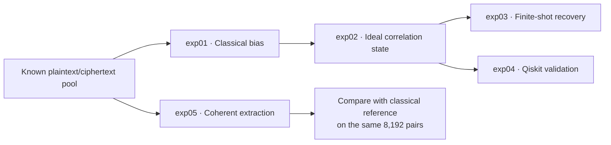
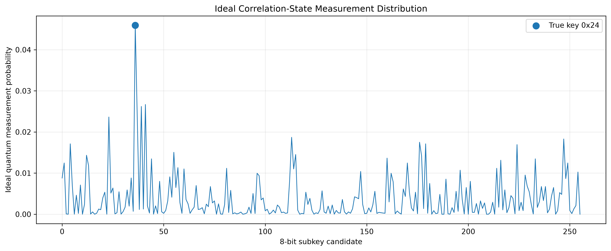
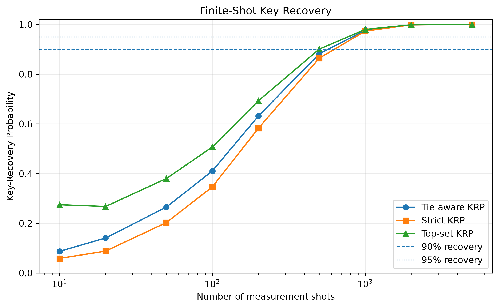
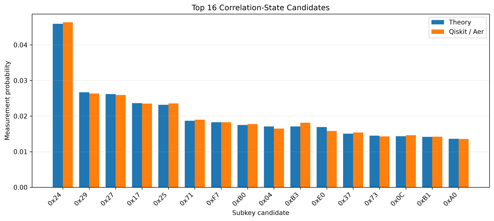
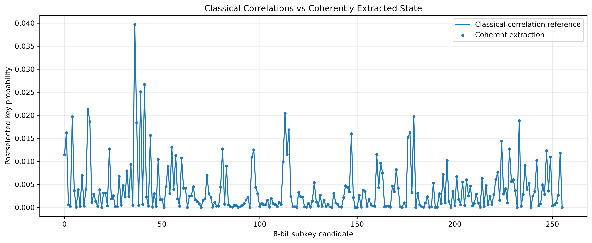

# Quantum Correlation Cryptanalysis

**From classical linear bias to quantum correlation states.**


A research implementation exploring how linear-cryptanalytic correlations can be encoded into quantum amplitudes, sampled for subkey recovery, and extracted through coherent interference. Five experiments connect a classical attack on the **16-bit, 4-round Heys SPN** to ideal-state analysis, finite-shot sampling, Qiskit validation, and coherent correlation extraction.

> **Current result:** the target 8-bit subkey `0x24` ranks first in the saved classical baseline, ideal probability distribution, Qiskit measurement histogram, and postselected coherent distribution. These experiments validate the correlation-state construction; they do not establish an end-to-end quantum speedup.

[Experiment overview](#experiment-overview) · [Core idea](#core-idea) · [Results](#results) · [Quick start](#quick-start) · [Repository guide](#repository-guide) · [Scope and limitations](#scope-and-limitations)

## Experiment overview

| Experiment | Question | Method | Saved result |
| :-- | :-- | :-- | :-- |
| [**exp01 · Classical baseline**](experiments/exp01_classical_baseline.py) | Which subkey has the strongest linear bias? | Evaluate 256 candidates over 10,000 known plaintext/ciphertext pairs. | `0x24` ranks **#1**, with bias **−0.029**. |
| [**exp02 · Ideal correlation state**](experiments/exp02_correlation_state.py) | How does bias translate into measurement probability? | Normalize the signed classical bias vector into amplitudes. | True-key probability **4.5937%**, or **11.76×** uniform sampling. |
| [**exp03 · Finite-shot sampling**](experiments/exp03_finite_shot_sampling.py) | How many measurements support reliable key selection? | Multinomial sampling at nine shot counts, with 5,000 trials each. | Tie-aware key recovery **97.67% at 1,000 shots**. |
| [**exp04 · Qiskit validation**](experiments/exp04_qiskit_state_validation.py) | Does a prepared circuit reproduce the target state and distribution? | 8-qubit state preparation and 100,000 Aer measurement shots. | State fidelity **≈ 1**; measured true-key probability **4.638%**. |
| [**exp05 · Coherent extraction**](experiments/exp05_coherent_correlation_extraction.py) | Can phase encoding and interference recover the correlation state? | Simulate a relation-phase oracle, Hadamard transform, and postselection on 8,192 pairs. | Reference-state fidelity **≈ 1**; postselection probability **0.03492%**. |

The diagram shows the experiment dependencies. exp05 regenerates the same plaintext/ciphertext pool as exp01 and uses its first 8,192 pairs; it does not require an earlier result file.



## Core idea

### 1. Measure a classical linear bias

Linear cryptanalysis exploits statistical relationships between plaintext bits and partially decrypted internal-state bits. For each candidate subkey $k$, this implementation evaluates the Heys relation

$$
r(k,i) = P_5 \oplus P_7 \oplus P_8
\oplus U_{4,6} \oplus U_{4,8}
\oplus U_{4,14} \oplus U_{4,16},
$$

where $i$ indexes a known plaintext/ciphertext pair and $U_4$ is the last-round S-box input estimated using $k$. Bit positions run from 1 (MSB) to 16 (LSB). The empirical bias and correlation are

$$
\epsilon_k = \Pr_i[r(k,i)=0] - \frac{1}{2},
\qquad
C_k = \mathbb{E}_i[(-1)^{r(k,i)}] = 2\epsilon_k.
$$

Candidates are ranked by absolute bias. The attack targets the second and fourth nibbles of the final whitening key $K_5$: bits 5–8 and 13–16. With $K_5=\texttt{0xA2B4}$, the target candidate is **`0x24`**, within a space of $K=256$ candidates.

### 2. Encode correlations into amplitudes

exp02 constructs the ideal state

$$
|\psi_C\rangle
= \frac{\sum_k \epsilon_k |k\rangle}{\sqrt{\sum_j \epsilon_j^2}},
\qquad
p_k = \frac{\epsilon_k^2}{\sum_j \epsilon_j^2}.
$$

The amplitudes retain the sign of the bias, while measurement probabilities depend on its square. This preserves the ordering by absolute bias and defines a nonuniform sampling distribution over subkey candidates.

### 3. Extract correlations through interference

exp05 simulates the joint key/data state after applying the relation-phase oracle:

$$
\frac{1}{\sqrt{KD}}\sum_{k,i}(-1)^{r(k,i)}|k\rangle|i\rangle.
$$

Applying Hadamard gates to the data-index register gives amplitude $C_k/\sqrt{K}$ on $|k\rangle|0\rangle$. Conditioning on the data register being all zero therefore produces the normalized correlation state. The probability of that postselection is

$$
P_{\mathrm{post}} = \frac{1}{K}\sum_k C_k^2.
$$

This probability matters when translating measurements of the conditional state into the number of full executions required.

## Results

The numbers below come from the committed [results](results/) using seed **`20261022`** and the fixed round keys in the experiment scripts. They describe this particular key and dataset instance.

### Classical baseline and ideal distribution · exp01–02

| Metric | Value |
| :-- | --: |
| Known plaintext/ciphertext pairs | 10,000 |
| True candidate / classical rank | `0x24` / 1 |
| True-key bias | −0.029000 |
| True-key measurement probability | 4.5937% |
| Strongest competing candidate / probability | `0x29` / 2.6678% |
| Uniform probability | 0.390625% |
| True-key probability relative to uniform | 11.76× |
| Shannon entropy / maximum | 6.8707 / 8 bits |



Sources: [classical candidate table](results/candidate_correlations.csv), [ideal-state summary](results/exp02_summary.json), and [candidate probabilities](results/exp02_quantum_probabilities.csv).

### Observing a key versus selecting it · exp03

**Hit probability** measures whether the true key appears at least once: $1-(1-p_*)^R$ for $R$ shots. **Key recovery probability (KRP)** measures whether the true key is selected as the measurement-histogram mode. Tie-aware KRP assumes uniform random selection among candidates tied for the largest count.

| Shots | Empirical hit probability | Tie-aware KRP |
| --: | --: | --: |
| 100 | 98.94% | 41.07% |
| 200 | 100.00% | 63.17% |
| 500 | 100.00% | 88.19% |
| 1,000 | 100.00% | 97.67% |
| 2,000 | 100.00% | 99.87% |

Each row summarizes **5,000 Monte Carlo trials**. Observed 100% rates are finite-sample estimates. The ideal hit model reaches 95% at 64 shots, while 1,000 shots is the first **tested** shot count exceeding 95% tie-aware KRP.



Sources: [sampling results](results/exp03_sampling_summary.csv) and [sampling summary](results/exp03_summary.json).

### Circuit-level state validation · exp04

Qiskit prepares the classically computed amplitude vector with `StatePreparation` and samples it with Aer. The exact state fidelity is approximately **1**, with maximum amplitude error **2.59 × 10⁻¹⁴**. Across **100,000 shots**, the true key appears **4,638 times** and remains the highest-count candidate; the empirical distribution has total variation distance **0.01632** from the target distribution.



Sources: [Qiskit summary](results/exp04_summary.json) and [measurement results](results/exp04_qiskit_measurements.csv).

### Coherent extraction and postselection cost · exp05

This experiment uses **8,192 pairs**, represented by an **8-qubit key register** and a **13-qubit data-index register**. The resulting conditional state agrees with the classical correlation reference computed on those same pairs.

| Metric | Value |
| :-- | --: |
| Coherent/reference state fidelity | ≈ 1 |
| Total variation distance | 1.89 × 10⁻¹⁶ |
| True-key conditional probability | 3.9700% |
| True-key conditional rank | 1 |
| Successful postselection probability | 0.03492% |
| Expected full runs per successful postselection | ≈ 2,864 |
| Full runs for ≥ 95% chance of at least one successful postselection | 8,579 |
| Joint probability of successful postselection and the true key per full run | 1.386 × 10⁻⁵ |



The conditional true-key probability differs from exp02 because exp05 uses fewer pairs. A successful postselection produces a sample from the correlation state; it does not by itself identify the correct key.

Sources: [coherent-extraction summary](results/exp05_summary.json) and [candidate-level comparison](results/exp05_coherent_probabilities.csv).

<details>
<summary>Additional result figures</summary>

- [exp02: top candidates](figures/exp02_top_candidates.png)
- [exp03: hit probability versus shots](figures/exp03_hit_probability_vs_shots.png)
- [exp04: full theoretical versus Qiskit distribution](figures/exp04_theory_vs_qiskit_full.png)
- [exp05: top coherent candidates](figures/exp05_coherent_top_candidates.png)

</details>

## Quick start

### Set up the environment

Use **Python 3.12**. From the repository root, create an environment and install the experiment dependencies:

```bash
conda create -n quantumCC python=3.12 pip
conda activate quantumCC
python -m pip install numpy pandas matplotlib qiskit qiskit-aer pytest
```

For the recorded package versions, use `python -m pip install -r requirements-lock.txt` in place of the final command. The [lock file](requirements-lock.txt) includes notebook tools and Windows-specific packages from the original environment, so it may need adjustment on other platforms. The existing [environment export](environment.yml) records Python 3.12 and a local Conda prefix; the commands above avoid depending on that machine-specific path.

### Run the experiments

```bash
python experiments/exp01_classical_baseline.py
python experiments/exp02_correlation_state.py
python experiments/exp03_finite_shot_sampling.py
python experiments/exp04_qiskit_state_validation.py
python experiments/exp05_coherent_correlation_extraction.py
```

Run exp01 before exp02, and exp02 before exp03 or exp04. exp05 can run independently. Scripts write CSV/JSON outputs to [results](results/) and plots to [figures](figures/), replacing the corresponding existing outputs. Sample counts, seeds, and other settings are defined near the top of each [experiment script](experiments/).

### Check the cipher implementation

```bash
python -m pytest test/ -q
```

The [cipher tests](test/test_heys_spn.py) cover the S-box inverse, permutation inverse, encryption/decryption round trips, and target-subkey extraction.

## Repository guide

| Location | Contents |
| :-- | :-- |
| [experiments/](experiments/) | The five runnable research experiments. |
| [src/heys_spn.py](src/heys_spn.py) | Heys SPN encryption, decryption, bit operations, and target-subkey extraction. |
| [src/linear_attack.py](src/linear_attack.py) | Linear relation evaluation and classical candidate ranking. |
| [results/](results/) | Candidate tables, sampling statistics, and experiment summaries. |
| [figures/](figures/) | Saved probability, recovery, and validation plots. |
| [test/](test/) | Cipher implementation tests. |
| [environment.yml](environment.yml) | Exported Conda environment metadata. |
| [requirements-lock.txt](requirements-lock.txt) | Recorded Python package versions. |

## Scope and limitations

- **Partial-key recovery:** the target is an 8-bit portion of the final whitening key in a small educational SPN, not recovery of every round key.
- **State preparation:** exp02 uses classical biases, and exp04 loads the resulting amplitudes into a circuit. Their sampling results do not account for an efficient quantum procedure to obtain those amplitudes.
- **Coherent access:** exp05 simulates the phase oracle and data-register transform at the state level. Reversible oracle synthesis, coherent plaintext/ciphertext lookup, qRAM, and their ancilla costs are not included; 21 qubits counts only the conceptual key and data-index registers.
- **Execution cost:** exp05 reports naive postselection overhead. Probability concentration alone is not an end-to-end runtime advantage, and amplitude amplification is not implemented.
- **Experimental coverage:** the saved results use one fixed key configuration and seed. They do not establish recovery rates across random keys or performance on noisy quantum hardware.
